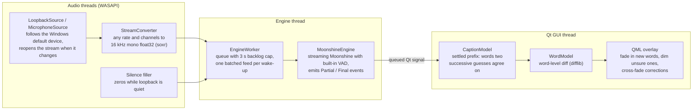

# EchoLine

**Offline live captions for anything playing on your Windows PC.**

[](https://github.com/coderconnoisseur/EchoLine/actions/workflows/release.yml)
[](https://github.com/coderconnoisseur/EchoLine/releases/latest)
[](LICENSE)


EchoLine captures whatever your PC is playing (videos, calls, games, podcasts),
runs [Moonshine](https://github.com/moonshine-ai/moonshine) speech recognition
locally, and draws the text in an always-on-top caption overlay. It works
offline after a one-time model download, and no audio leaves your machine.

<!-- TODO(owner): add a hero GIF of the overlay captioning a video, e.g.
<p align="center"></p>
-->

**[Download EchoLine-Setup.exe](https://github.com/coderconnoisseur/EchoLine/releases/latest)** · Windows 10/11, 64-bit, no admin rights needed

- **Any audio, no Stereo Mix:** WASAPI loopback capture of system audio, or your microphone for in-person talks and lectures
- **Follows your output device:** switch to headphones or Bluetooth and captions keep going
- **Sound to screen in 266 ms (p50) / 438 ms (p95)** on a 4-core laptop CPU ([measurements](docs/benchmarks/2026-10-engine-bench.md#live-pipeline-check-tiny-real-loopback-audio))
- **Readable while it streams:** unsure words are dimmed, corrections cross-fade in place
- **Customizable:** four caption themes, rolling lines or film-style subtitle blocks, global hotkeys, click-through

## How it works



1. **Capture.** [`echoline/audio/wasapi.py`](echoline/audio/wasapi.py) asks Windows Core Audio (pycaw) for the current default endpoint and opens a WASAPI loopback stream on it with PyAudioWPatch. A poll thread reopens the stream when the default device changes or disappears, so switching to headphones does not stop captions. Loopback delivers nothing while the PC is silent, so the source emits blocks of zeros; the recognizer needs to hear silence to decide a sentence has ended.
2. **Resample.** [`echoline/audio/convert.py`](echoline/audio/convert.py) turns device audio of any sample rate and channel count into 16 kHz mono float32 with a streaming soxr resampler.
3. **Recognize.** [`echoline/pipeline/worker.py`](echoline/pipeline/worker.py) feeds queued audio to the engine on its own thread. It concatenates everything queued into a single feed (per-call cost dominates, so feeding block by block never catches up) and drops the oldest audio beyond a 3 s backlog, showing "Catching up…" instead of falling further and further behind. [`echoline/engine/moonshine_engine.py`](echoline/engine/moonshine_engine.py) wraps a Moonshine stream, whose voice activity detection splits speech into lines, and turns its events into `Partial` (may still change) and `Final` (settled) text per utterance.
4. **Stabilize.** [`echoline/captions/model.py`](echoline/captions/model.py) marks as settled the leading words that two successive guesses agree on, and settles the rest once a guess has held for 600 ms. [`echoline/captions/words.py`](echoline/captions/words.py) applies each new guess as a minimal word-level diff, so the overlay only animates the words that actually changed.
5. **Render.** [`echoline/ui/qml/CaptionLine.qml`](echoline/ui/qml/CaptionLine.qml) fades new words in, draws unsettled words at reduced opacity, and cross-fades corrected words in place. Latency is measured from audio capture to the overlay's next `frameSwapped`, i.e. when the text is actually on screen.

## Engineering highlights

- **Measured end-to-end latency.** Sound-to-screen latency is tracked live as rolling percentiles (`--show-latency`, [`echoline/pipeline/latency.py`](echoline/pipeline/latency.py)). With Moonshine Tiny on an AMD Ryzen 5 3550H it measured **p50 266 ms / p95 438 ms** on an idle machine, inside the design targets of p50 < 300 ms and p95 < 600 ms ([benchmark](docs/benchmarks/2026-10-engine-bench.md)).
- **A profiled streaming-lag fix.** Captions fell behind during long continuous speech. Profiling showed engine time per 10 s of audio growing from 3.9 s to 10.5 s with session length, because every update returned all past audio. Turning off `return_audio_data` and raising the backlog limit from 1 s to 3 s took dropped audio from 6.0 s of 110 s to zero. Lowering Moonshine's native `transcription_interval` to 0.1 s then cut word-lag p90 from 600–660 ms to 270–290 ms with WER unchanged at 0.131 ([investigation](docs/benchmarks/2026-10-engine-bench.md#streaming-lag-investigation-2026-10-03)).
- **Data-driven model choice.** [`echoline/bench.py`](echoline/bench.py) compares engines on 73 LibriSpeech clips (WER, real-time factor, p95 chunk time). Moonshine beat Vosk at every size: WER 0.130 / 0.080 / 0.062 for Tiny / Small / Medium against Vosk's 0.151. On first run, a hardware check ([`echoline/models.py`](echoline/models.py)) times Tiny on a bundled clip and picks the more accurate Small model only when the CPU has the headroom.
- **Tests that need no model or sound card.** The suite runs on fake speech engines, fake audio devices and Qt's offscreen platform with a simulated 1366x768 screen at 125 % scaling ([`tests/conftest.py`](tests/conftest.py)), so QML views, the tray, hotkeys and the setup flow are tested headlessly. Tests that load real models are marked `model` and skipped by default ([`pytest.ini`](pytest.ini)).
- **Tag-to-installer release pipeline.** Pushing a `v*` tag runs [`.github/workflows/release.yml`](.github/workflows/release.yml): run the tests, stamp the version into the app, build with PyInstaller ([`packaging/echoline.spec`](packaging/echoline.spec)), build an Inno Setup installer ([`packaging/installer.iss`](packaging/installer.iss)) and a portable zip, write `SHA256SUMS.txt`, and publish a GitHub release (tags containing `-` become pre-releases).
- **Robustness details.** A corrupt `settings.json` is moved aside to `settings.json.bak` and the app starts with defaults ([`echoline/settings/model.py`](echoline/settings/model.py)). Downloaded model files are checked for size and CRC32C before use ([`echoline/models.py`](echoline/models.py)). A second launch hands off to the running copy over a local socket ([`echoline/instance.py`](echoline/instance.py)). The model loads on a background thread, so the overlay stays responsive while it loads.

## Install

1. Download **EchoLine-Setup.exe** from the
   [latest release](https://github.com/coderconnoisseur/EchoLine/releases/latest)
   (Windows 10 or 11, 64-bit). No admin rights needed.
2. Run it. The installer is not code-signed yet, so Windows may show
   "Windows protected your PC": click **More info → Run anyway**.
3. EchoLine starts with a short setup: it downloads the speech model
   (45 MB, once), checks your PC, plays a sound test and lets you pick a look.

Prefer no installer? Download the portable `.zip`, extract it anywhere and run
`EchoLine.exe`. Each release includes `SHA256SUMS.txt` for checking the
downloads. If something goes wrong, `%LOCALAPPDATA%\EchoLine\echoline.log`
says why; please attach it to an issue.

## Run from source

Requires Windows 10 or 11 and Python 3.10 or higher.

```bash
git clone https://github.com/coderconnoisseur/EchoLine.git
cd EchoLine
pip install -r requirements.txt
python -m echoline
```

The first launch opens a short setup: it downloads the speech model (45 MB,
or 190 MB if your PC is fast enough for the more accurate Small model), runs a
sound test and lets you pick a look. Models are stored in
`%LOCALAPPDATA%\EchoLine\models`. Launching EchoLine again while it runs
brings the running copy forward.

Options:
- `--model tiny|small|medium`: use this model for one run instead of the one chosen at setup (switch for good under Settings → Behavior → Speech model)
- `--show-latency`: show how long captions take to appear (p50 / p95)

## Development

**Tests**

```bash
pip install -r requirements-dev.txt
python -m pytest              # fake engines and devices, offscreen Qt
python -m pytest -m model     # tests that load real speech models
```

**Benchmarks.** Compare speech engines on reference clips (accuracy and speed):

```bash
python -m scripts.fetch_bench_clips
python -m echoline.bench --engines moonshine-tiny moonshine-small
```

Results for the reference machine are in [docs/benchmarks](docs/benchmarks/).
The transcription metrics package is documented in [metrics/README.md](metrics/README.md).

**Building the installer locally**

```bash
pip install pyinstaller==6.16.0
python -m PyInstaller packaging/echoline.spec --noconfirm --distpath build/dist --workpath build/work
iscc /DAppVersion=0.3.0 packaging\installer.iss
```

Releases are built by GitHub Actions: pushing a tag such as `v0.3.0` (or
`v0.3.0-beta.1` for a pre-release) tests, builds and publishes the installer,
a portable zip and `SHA256SUMS.txt`.

## Using EchoLine

<details>
<summary><b>Controls and hotkeys</b></summary>

- **Tray icon:** left-click hides or shows the captions. Right-click for pause,
  click-through, audio source (system audio or microphone), settings and quit.
- **Hover bar:** move the pointer over the captions for pause, source,
  settings and hide buttons.
- **Hotkeys** (work while other apps have focus; change them in Settings → Shortcuts):
  - `Ctrl+Alt+Shift+C` show or hide captions
  - `Ctrl+Alt+Shift+P` pause or resume
  - `Ctrl+Alt+Shift+T` click-through on or off
- **Click-through:** the captions ignore the mouse so you can click the video
  under them. Turn it off with `Ctrl+Alt+Shift+T` or from the tray icon.
- **Move and resize:** drag the overlay anywhere, or drag its edges to resize.
  It remembers where you put it, and can snap to the top, center or bottom of the screen.

Hiding the captions keeps EchoLine running in the tray; quit from the tray
menu or the captions' right-click menu.

</details>

<details>
<summary><b>Customizing</b></summary>

Right-click the captions, or use the tray icon, to open Settings. Pages on the
left cover Appearance, Position, Behavior, Speech, Shortcuts and About; a live
preview at the top shows every change, and the window follows Windows' light or
dark theme and accent colour. Changes apply immediately.

- Four caption themes (Classic CC, Netflix, Minimal, High contrast), plus full
  control over font, size, colors, outline, background, width and line count
- Smoothly rolling caption lines, or film-style subtitle blocks
- Auto-hide after silence, start with Windows

Settings are stored in `%APPDATA%\EchoLine\settings.json`; if that file is
damaged, EchoLine backs it up as `settings.json.bak` and starts with defaults.

Captions arrive word by word: new words fade in, words the engine is still
unsure about are dimmed and brighten once they settle, and corrections
cross-fade in place. If "Show animations in Windows" is turned off
(Windows Settings → Accessibility → Visual effects), captions update without motion.

</details>

<details>
<summary><b>Troubleshooting</b></summary>

**No captions appear**
- Check that sound is playing through your default output device and is not muted.
- If the overlay shows "No audio device", connect or enable an output device; EchoLine picks it up automatically.

**Captions lag behind ("Catching up…")**
- Your CPU cannot keep up with the selected model. Choose Tiny under Settings → Behavior → Speech model.

**Anything else**
- `%LOCALAPPDATA%\EchoLine\echoline.log` says what went wrong; please attach it to an issue.

</details>

## Roadmap

Planned work and product ideas are in [docs/ROADMAP.md](docs/ROADMAP.md).

## License

EchoLine is released under the [MIT License](LICENSE). It uses
[Moonshine](https://github.com/moonshine-ai/moonshine) English speech models
(MIT) and [Qt for Python](https://www.qt.io/qt-for-python) (LGPL-3.0).
